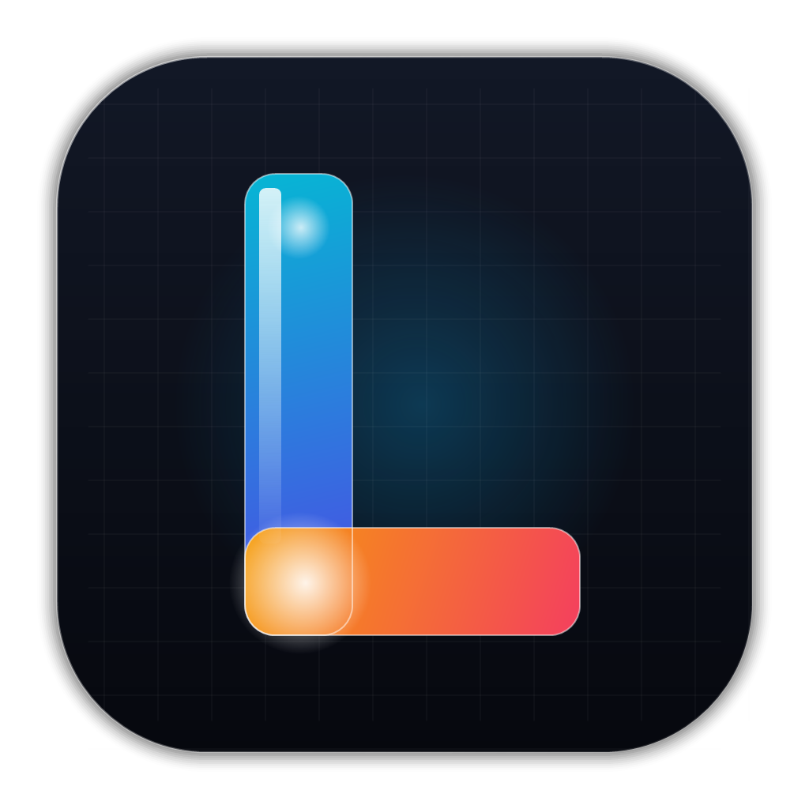

#  Lumen — Инновационные Живые Обои для Windows

[-0078d4?style=for-the-badge&logo=windows)](https://github.com/PUMBALumen/Lumen)

> **Lumen** — современный движок живых интерактивных обоев для рабочего стола Windows. Он сочетает высокую производительность (60+ FPS при 0% нагрузки в играх), 3D-параллакс глубину и интерактивное управление медиаплеером прямо с экрана.

---

## 📥 Скачать приложение

| Файл | Описание | Ссылка |
| :--- | :--- | :--- |
| **`LumenSetup.exe`** | Официальный быстрый инсталлятор (v1.0.0) | [**Скачать LumenSetup.exe (v1.0.0)**](https://github.com/PUMBALumen/Lumen/releases/download/v1.0.0/LumenSetup.exe) |

---

## 🔥 Ключевые возможности

### 🌌 1. 3D-Параллакс глубина рабочего стола
Слои обоев и виджеты мягко наклоняются и следуют за курсором мыши в трёхмерном пространстве.
- Ползунок силы наклона: от лёгкого до глубокого 3D-объёма.
- Раздельное управление наклоном виджетов и фонового медиа.

### 🎵 2. Интерактивный плеер на рабочем столе
Управляйте музыкой без переключения окон! При наведении курсора на виджет музыки появляются кликабельные кнопки:
- ⏮ **Предыдущий трек**
- ⏯ **Пауза / Воспроизведение**
- ⏭ **Следующий трек**
- **Поддержка сервисов:** Яндекс Музыка, VK Музыка, Spotify и любые веб-браузеры (Chrome, Edge, Яндекс Браузер, Opera, Firefox).

### ⏱ 3. Эстетичные часы и кастомный текст
- Стиль **Mond**, минималистичные карточки, дата и день недели.
- Ваш собственный текст на рабочем столе с кастомизацией шрифта, масштабирования и неонового свечения.

### 🎨 4. Поддержка любых обоев и живые эффекты
- Воспроизведение видео в форматах **MP4** и **WebM** (с аппаратным декодированием GPU).
- Поддержка статичных фото высокой чёткости (**JPG / PNG**).
- Наложение живых слоев поверх любых обоев: неоновый дождь, звёзды, матрица и частицы.

### ⚡ 5. Ультра-производительность (0% CPU в играх)
- **Умная автопауза:** при запуске любых игр или полноэкранных приложений Lumen автоматически встаёт на паузу, освобождая все ресурсы процессора и видеокарты.
- Плавная частота обновления **60+ FPS**.
- Полная поддержка экранов **2K / 4K** и многомониторных конфигураций.

### 🔒 6. Чистая и надёжная сборка
- Никаких открытых скриптов в папке: приложение упаковано в монолитный исполняемый файл.
- Удобный переключатель автозапуска вместе с Windows прямо в настройках приложения.

---

## 💻 Системные требования

* **ОС:** Windows 10 (1903+) или Windows 11 (64-bit)
* **Процессор:** 2-ядерный процессор с частотой от 1.8 GHz
* **ОЗУ:** 2 GB оперативной памяти
* **Видеокарта:** С поддержкой DirectX 11 / аппаратного ускорения видео
* **Место на диске:** ~80 MB свободного места

---

## 🚀 Быстрый старт

1. Скачайте инсталлятор **`LumenSetup.exe`**.
2. Запустите установку (программа установится за несколько секунд).
3. Приложение сразу применит живые обои и свернётся в системный трей (возле часов Windows).
4. Нажмите правой кнопкой мыши по значку Lumen в трее (или дважды кликните по нему), чтобы открыть панель настроек.

---

## 💬 Сообщество и поддержка

Присоединяйтесь к нашему официальному сообществу в **Discord**:
👉 **[Вступить в Discord Lumen](https://discord.gg/fkktETKmp)**

*Делитесь вашими живыми обоями, предлагайте идеи новых фич и первыми узнавайте о свежих обновлениях!*

---

  <b>Lumen Live Wallpapers</b> • Создано с ❤️ разработчиком <b>Pumba</b>

